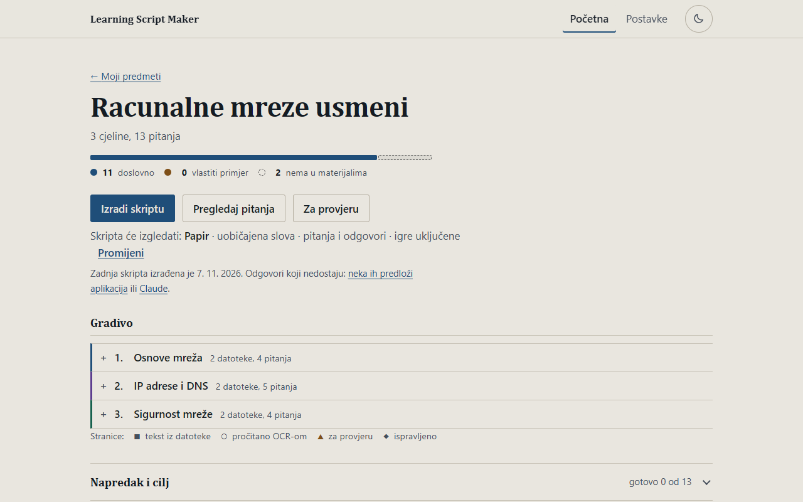
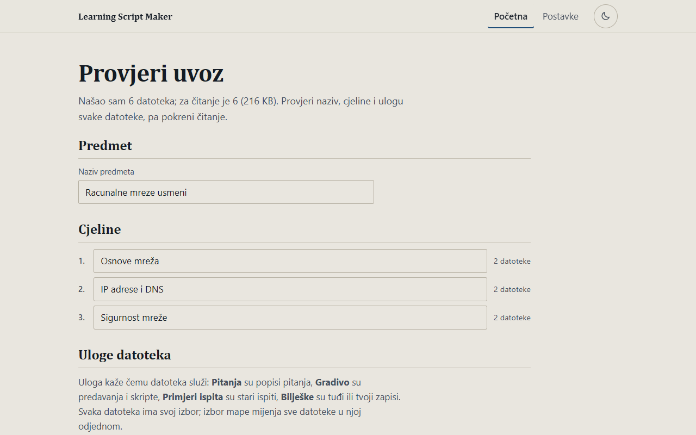
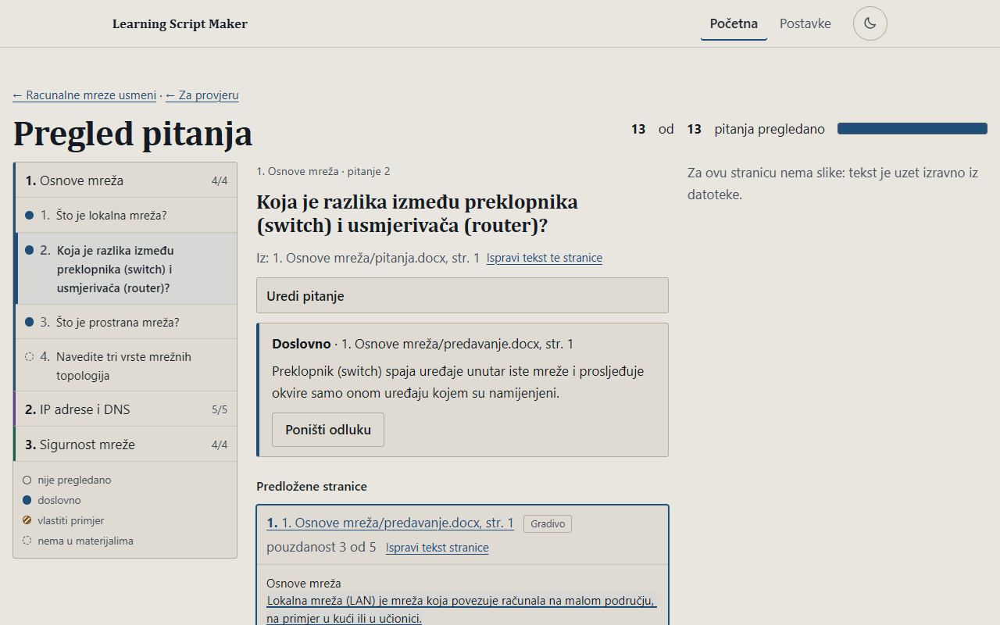
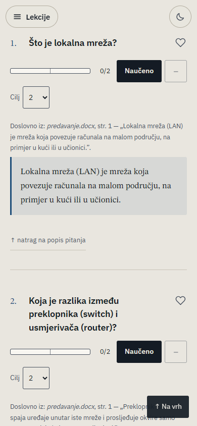

# Learning Script Maker

A local web app that turns study material (scanned or text PDFs, Word, PowerPoint, phone photos of notes, a folder or a
zip) plus an exam question list into one self-contained HTML study script that works offline on a phone: questions and
answers, a progress bar, flashcards and a quiz.

Its rule: every answer is copied **word for word** from the material and checked by a program against the cited file and
page, or it is clearly marked as an own example, or shown as "not in the material". Nothing is invented. Everything works
without an API key; Gemini and Claude are optional helpers. The interface is in Croatian.



| Import | Review | The finished script (phone) |
|---|---|---|
|  |  |  |

The screenshots show a made-up sample folder, not real study material. More in [docs/showcase/SHOWCASE.md](docs/showcase/SHOWCASE.md),
with a clickable [sample script](docs/showcase/sample-script.html).

## Run it

Windows, Python 3.11 and [uv](https://docs.astral.sh/uv/). Tesseract is optional (OCR of scans).

```
uv sync
uv run uvicorn scriptmaker.app:create_app --factory --host 127.0.0.1 --port 8765
```

Open http://127.0.0.1:8765, or double-click `start.bat`. The app only listens on this computer. To try it without any real
material: `uv run python docs/showcase/showcase_demo.py` and open http://127.0.0.1:8780.

Tests: `uv run pytest` (some tests need a private sample folder and skip without it). Lint: `uv run ruff check .`.

## What works and what does not (2026-11-07)

Works: folder and zip import, text reading and OCR, question detection, the word-for-word verifier, review screens,
building the offline script (light and dark, accessible, formulas), flashcards and quiz inside the script, optional Gemini
page reading.

Not finished, honestly:
- **Milestone 1 fails for now**: on the real test folder the app covers 77 of 91 reference questions (85%) against a goal of
  95%. 47 word-for-word answers were all re-checked and passed; 46 questions are still open.
- The optional answer picker (Gemini, or a local model) is built and tested but has not had its first real run.
- The exam planner, time estimates, notifications, more game types and security review are not started.

Status per step: see docs/showcase/SHOWCASE.md. Study materials and generated scripts are private and are
never committed.
